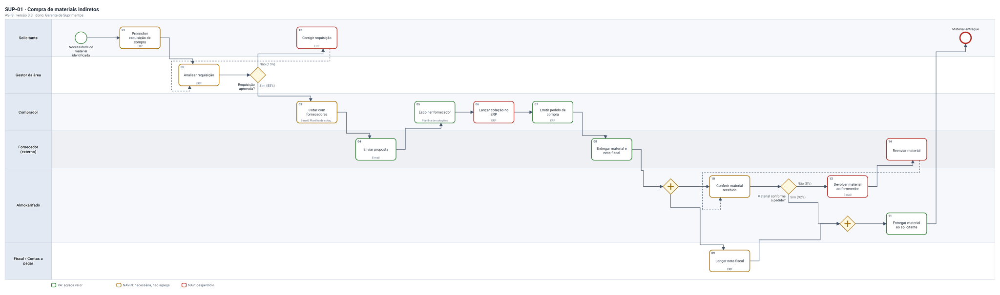
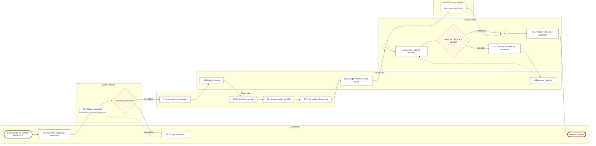

# SUP-01 · Compra de materiais indiretos

Mapeamento de processo · AS-IS · versão 0.3  
**RASCUNHO: ainda sem aceite do dono do processo**

## 1. Ficha do processo

| Campo | Valor |
|---|---|
| Dono do processo | Gerente de Suprimentos |
| Área | Suprimentos |
| Macroprocesso | Gestão de suprimentos |
| Objetivo | Entregar ao solicitante o material de uso interno (escritório, manutenção, TI) no prazo combinado, pelo menor custo total e com a despesa autorizada. |
| Gatilho | Uma área precisa de material que não há no estoque |
| Resultado | Material entregue ao solicitante e nota fiscal lançada para pagamento |
| Frequência / volume | contínuo · cerca de 120 requisições por mês |

## 2. Escopo

- **Começa em:** Solicitante abre a requisição de compra
- **Termina em:** Nota fiscal lançada no contas a pagar e material entregue
- **Inclui:** materiais indiretos até R$ 50 mil
- **Não inclui:** compra de matéria-prima (processo SUP-02); pagamento ao fornecedor (processo FIN-03); contratação de serviços

## 3. SIPOC

| Fornecedores | Entradas | Processo | Saídas | Clientes |
|---|---|---|---|---|
| Áreas solicitantes Fornecedores cadastrados Controladoria (orçamento) | Necessidade de material Orçamento da área Cotações Nota fiscal | Preencher requisição de compra Analisar requisição Cotar com fornecedores Lançar cotação no ERP Emitir pedido de compra Lançar nota fiscal Entregar material ao solicitante | Pedido de compra Material entregue Nota fiscal lançada | Área solicitante Contas a pagar |

## 4. Fluxograma

## 5. Descrição das atividades

| Nº | Atividade | Responsável | Sistema | Entradas | Saídas | Regras | Tempo | Valor |
|---|---|---|---|---|---|---|---|---|
| 01 | Preencher requisição de compra | Solicitante | ERP | — | Requisição de compra | — | exec. 15 min | NAV-N |
| 02 | Analisar requisição | Gestor da área | ERP | — | — | R1 | exec. 10 min · espera 2 d úteis | NAV-N |
| 03 | Cotar com fornecedores | Comprador | E-mail, Planilha de cotações | — | Mapa de cotação | R2 | exec. 1 h · espera 3 d úteis | NAV-N |
| 04 | Enviar proposta | Fornecedor | E-mail | — | — | — | exec. 1 h · espera 2 d úteis | VA |
| 05 | Escolher fornecedor | Comprador | Planilha de cotações | — | — | R3 | exec. 30 min | VA |
| 06 | Lançar cotação no ERP | Comprador | ERP | — | — | — | exec. 20 min | NAV |
| 07 | Emitir pedido de compra | Comprador | ERP | — | Pedido de compra | — | exec. 10 min | VA |
| 08 | Entregar material e nota fiscal | Fornecedor | manual | — | — | — | exec. 1 h · espera 5 d úteis | VA |
| 09 | Lançar nota fiscal | Fiscal / Contas a pagar | ERP | — | — | R5 | exec. 15 min · espera 1 d útil | NAV-N |
| 10 | Conferir material recebido | Almoxarifado | manual | — | — | R4 | exec. 20 min · espera 4 h | NAV-N |
| 11 | Entregar material ao solicitante | Almoxarifado | manual | — | — | — | exec. 15 min · espera 4 h | VA |
| 12 | Corrigir requisição | Solicitante | ERP | — | — | — | exec. 10 min · espera 1 d útil | NAV |
| 13 | Devolver material ao fornecedor | Almoxarifado | E-mail | — | — | — | exec. 30 min · espera 1 d útil | NAV |
| 14 | Reenviar material | Fornecedor | manual | — | — | — | exec. 1 h · espera 3 d úteis | NAV |

**01 · Preencher requisição de compra**  
Abre a requisição no ERP com item, quantidade, centro de custo e justificativa.  

**02 · Analisar requisição**  
Confere necessidade, centro de custo e saldo de orçamento.  

**03 · Cotar com fornecedores**  
Pede cotação por e-mail e consolida as propostas na planilha.  

**06 · Lançar cotação no ERP**  
Redigita no ERP os preços que já estão na planilha.  

## 6. Decisões e regras de negócio

| Decisão | Quem decide | Caminhos | Regras |
|---|---|---|---|
| Requisição aprovada? | Gestor da área | Sim → Cotar com fornecedores (85%) Não → Corrigir requisição (15%) | — |
| Material conforme o pedido? | Almoxarifado | Sim → Entregar material ao solicitante (92%) Não → Devolver material ao fornecedor (8%) | — |

| Regra | Texto | Fonte |
|---|---|---|
| R1 | O gestor aprova até R$ 10 mil; acima disso, também o diretor da área (Tabela de alçadas 2026). | Tabela de alçadas 2026 |
| R2 | Compras acima de R$ 5 mil exigem no mínimo 3 cotações. | PC-001, item 4.2 |
| R3 | Vence o menor custo total (preço + frete + prazo), entre fornecedores homologados. | PC-001, item 4.5 |
| R4 | Quantidade e especificação devem bater com o pedido; divergência acima de 2% é devolvida. | Prática do almoxarifado |
| R5 | A nota só é lançada com pedido de compra aprovado (conferência de 3 vias: pedido, recebimento, nota). | Controladoria |

## 7. Matriz RACI

| Nº | Atividade | Solicitante | Gestor da área | Comprador | Fornecedor | Almoxarifado | Fiscal / Contas a pagar |
|---|---|---|---|---|---|---|---|
| 01 | Preencher requisição de compra | R | — | — | — | — | — |
| 02 | Analisar requisição | I | RA | — | — | — | — |
| 03 | Cotar com fornecedores | — | — | R | — | — | — |
| 04 | Enviar proposta | — | — | — | R | — | — |
| 05 | Escolher fornecedor | — | — | R | — | — | — |
| 06 | Lançar cotação no ERP | — | — | R | — | — | — |
| 07 | Emitir pedido de compra | — | — | R | — | — | — |
| 08 | Entregar material e nota fiscal | — | — | — | R | — | — |
| 09 | Lançar nota fiscal | — | — | — | — | — | R |
| 10 | Conferir material recebido | — | — | — | — | R | — |
| 11 | Entregar material ao solicitante | — | — | — | — | R | — |
| 12 | Corrigir requisição | R | — | — | — | — | — |
| 13 | Devolver material ao fornecedor | — | — | — | — | R | — |
| 14 | Reenviar material | — | — | — | R | — | — |

## 8. Indicadores

| Indicador | Fórmula | Hoje (linha de base) | Meta | Polaridade | Periodicidade | Fonte | Dono |
|---|---|---|---|---|---|---|---|
| Lead time da requisição | data de entrega ao solicitante - data de abertura da requisição (dias úteis) | 14 dias úteis (estimado na entrevista) | ≤ 10 dias úteis | menor é melhor | mensal | ERP | Gerente de Suprimentos |
| Requisições devolvidas para correção | requisições reprovadas / requisições analisadas | ≈ 25% (estimado) | ≤ 5% | menor é melhor | mensal | ERP | Gerente de Suprimentos |
| Saving de compras | (maior cotação - cotação escolhida) / maior cotação | não medido hoje | ≥ 8% | maior é melhor | trimestral | Planilha de cotações | Gerente de Suprimentos |

## 9. Análise do processo

- Caminho feliz (o caso mais comum): Necessidade de material identificada → Preencher requisição de compra → Analisar requisição → Cotar com fornecedores → Enviar proposta → Escolher fornecedor → Lançar cotação no ERP → Emitir pedido de compra → Entregar material e nota fiscal → Lançar nota fiscal → Entregar material ao solicitante → Material entregue
- Lead time do caminho feliz: **14,1 d úteis** (esforço 5,2 h, eficiência do ciclo 4%)
- Lead time esperado, com exceções, retrabalho e todos os desfechos (inclusive recusas): **15 d úteis** · 50% dos casos até 14,1 d úteis, 80% até 17,2 d úteis, 90% até 18,4 d úteis
- Passagens de bastão no caso típico: 7 · laços de retrabalho: 2
- Os tempos são estimativas da entrevista, não medição.

### Carga de trabalho (capacidade)

| Papel | Horas por mês | Pessoas equivalentes (160 h/mês) |
|---|---|---|
| Comprador | 240 | 1,5 |
| Almoxarifado | 79 | 0,5 |
| Solicitante | 34 | 0,2 |
| Fiscal / Contas a pagar | 30 | 0,2 |
| Gestor da área | 24 | 0,1 |
| **Total** | **406** | **2,5** |

_120 casos por mês × vezes que cada atividade roda × execução; jornada cheia, é o mínimo de gente._

### Oportunidades

1. [Espera] Espera de 3 d úteis antes de "Cotar com fornecedores": o que segura? (fila, alçada, lote, agenda). Prazo combinado (SLA) ou gatilho automático ajudam.
2. [Defeitos (retrabalho)] Retrabalho: de "Corrigir requisição" volta para "Analisar requisição" (15% das vezes; 0,18 volta por caso). Ataque a causa na origem (checklist, campo obrigatório, validação no sistema) em vez de conferir depois.
3. [Espera] Prazo de 5 d úteis de quem é de fora em "Entregar material e nota fiscal": dá para combinar prazo em contrato (SLA), pedir antes ou acompanhar com lembrete?
4. [Espera] Espera de 2 d úteis antes de "Analisar requisição": o que segura? (fila, alçada, lote, agenda). Prazo combinado (SLA) ou gatilho automático ajudam.
5. [Defeitos (retrabalho)] Retrabalho: de "Reenviar material" volta para "Conferir material recebido" (8% das vezes; 0,09 volta por caso). Ataque a causa na origem (checklist, campo obrigatório, validação no sistema) em vez de conferir depois.
6. [Transporte (passagem de bastão)] No caso típico, o trabalho troca de mãos 7 vezes em 10 atividades: cada troca é fila e risco de perda. Veja se atividades seguidas podem ficar com o mesmo responsável.
7. [Superprocessamento] "Lançar cotação no ERP" foi classificada como desperdício (NAV): dá para eliminar ou prevenir?
8. [Superprocessamento] "Corrigir requisição" foi classificada como desperdício (NAV): dá para eliminar ou prevenir?
9. [Superprocessamento] "Devolver material ao fornecedor" foi classificada como desperdício (NAV): dá para eliminar ou prevenir?
10. [Superprocessamento] "Reenviar material" foi classificada como desperdício (NAV): dá para eliminar ou prevenir?

## 10. Dores, melhorias e riscos

| Id | Dor | Onde | Impacto |
|---|---|---|---|
| D1 | Requisição volta para correção porque falta centro de custo ou especificação. | Preencher requisição de compra, Requisição aprovada? | alto |
| D2 | A cotação é redigitada da planilha para o ERP, com erro de preço às vezes. | Lançar cotação no ERP | médio |
| D3 | Aprovação do gestor fica parada dias na caixa de entrada. | Analisar requisição | alto |

| Id | Ação | Resolve | Esforço | Responsável | Prazo | Situação |
|---|---|---|---|---|---|---|
| M1 | Campos obrigatórios e catálogo de itens na requisição do ERP | D1 | baixo | Analista de TI do ERP | 30/11/2026 | aprovada |
| M2 | Cotação direto no ERP (portal do fornecedor), sem planilha | D2 | médio | Gerente de Suprimentos | 31/03/2027 | proposta |
| M3 | Aprovação pelo celular com lembrete automático em 24h e SLA de 1 dia útil | D3 | baixo | Gerente de Suprimentos | 15/12/2026 | em andamento |

| Id | Risco | Onde | Nível | Controle | Tipo |
|---|---|---|---|---|---|
| K2 | Compra direcionada a um fornecedor | Cotar com fornecedores, Escolher fornecedor | alto | Mínimo de 3 cotações acima de R$ 5 mil (R2) | preventivo |
| K1 | Pagamento de nota sem material recebido | Lançar nota fiscal | médio | Conferência de 3 vias no lançamento (R5) | preventivo |

## 11. Glossário, normas e pendências

| Termo | Definição |
|---|---|
| Material indireto | Material que não entra no produto vendido (escritório, manutenção, TI). |
| Conferência de 3 vias | Pedido, recebimento e nota fiscal precisam bater antes do lançamento. |

**Normas e referências**

- Política de Compras PC-001 rev. 4
- Tabela de alçadas 2026
- [ ] Confirmar com a Controladoria se a alçada de R$ 10 mil vale para TI.

## 12. Participantes e histórico

| Nome | Papel | Data |
|---|---|---|
| Ana Ribeiro | Compradora | 28/10/2026 |
| Carlos Mendes | Gerente de Suprimentos | 28/10/2026 |

| Versão | Data | Autor | Mudança |
|---|---|---|---|
| 0.1 | 28/10/2026 | Ana Ribeiro | Entrevista inicial |
| 0.3 | 30/10/2026 | Ana Ribeiro | Recebimento em paralelo com o fiscal |

_RASCUNHO: ainda sem aceite do dono do processo. Gerado pelo Senku a partir do carta.json._
